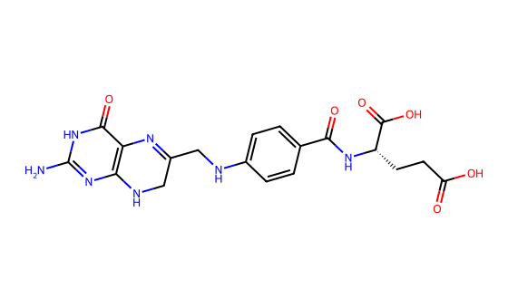
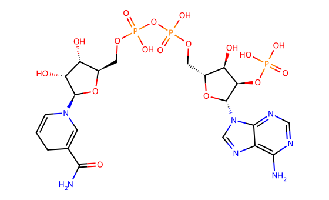
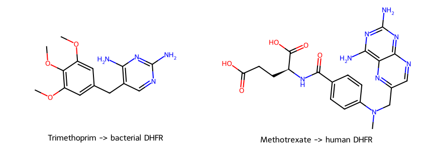
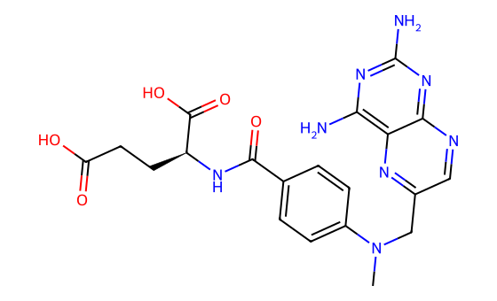
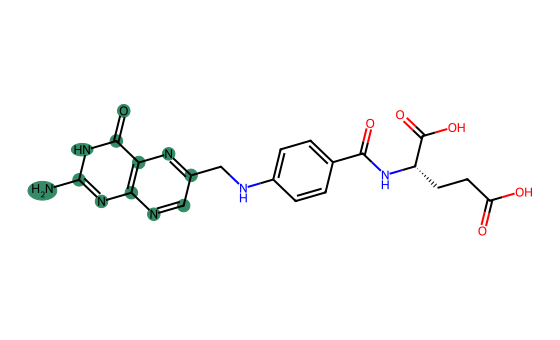
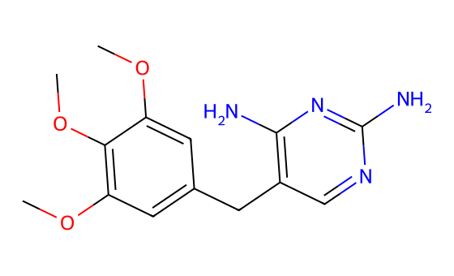
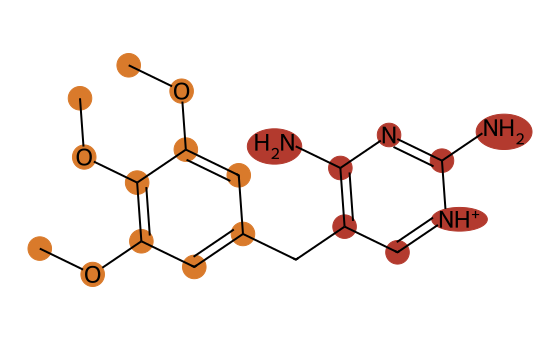

# Interpreting this project: a guide from first principles

Written for someone meeting structural biology and computational chemistry for the
first time. Nothing here assumes prior biochemistry. Read it in order; each part uses
the one before.

The last two parts are the ones you need for the write-up: **Part 9** walks through every
number this project produced, and **Part 10** says what you may and may not claim.

---

## Contents

1. [The biology](#1-the-biology)
2. [The chemistry](#2-the-chemistry)
3. [Pharmacology: how drug strength is measured](#3-pharmacology-how-drug-strength-is-measured)
4. [Energy: the language everything converts into](#4-energy-the-language-everything-converts-into)
5. [Structural biology: where the coordinates come from](#5-structural-biology-where-the-coordinates-come-from)
6. [AlphaFold](#6-alphafold)
7. [Docking](#7-docking)
8. [Statistics](#8-statistics)
9. [Reading our actual results](#9-reading-our-actual-results)
10. [What you may and may not claim](#10-what-you-may-and-may-not-claim)
11. [Quick reference](#11-quick-reference)

---

## 1. The biology

### Enzymes

An **enzyme** is a protein that speeds up one specific chemical reaction. It works by
holding the reacting molecules in exactly the right position. The pocket where this
happens is the **active site**: usually a cleft or groove, and usually a small part of
the whole protein.

The molecule an enzyme acts on is its **substrate**. The molecule it produces is the
**product**.

### Folate, and why cells need it

Cells build DNA constantly. Building the "letters" of DNA, specifically thymidine and
the purines, requires attaching single carbon atoms to larger molecules. Cells don't
have free carbon atoms lying around, so they use a carrier.

That carrier is **tetrahydrofolate (THF)**, the active form of folate (vitamin B9). THF
picks up a one-carbon unit, delivers it, and in the process gets chemically used up.

Specifically: every time a cell makes thymidylate (a DNA building block), one THF is
spent and comes back as **dihydrofolate (DHF)**: a "flat", used-up version.

### What DHFR does

**DHFR** is **dihydrofolate reductase**. Its job is recycling: it converts spent DHF back
into usable THF.

```
DHF  +  NADPH  +  H⁺   ──DHFR──>   THF  +  NADP⁺
```

"Reductase" means it performs a **reduction**: chemically, adding electrons (here, in
the form of a hydride, H⁻). Reduction always comes paired with an **oxidation**
somewhere else; something has to supply those electrons.

Here are the two molecules either side of that arrow. The **pterin ring** is the
double-ring system at the far left of each. That's the business end, and the only part
that changes:

| Substrate, dihydrofolate (DHF) | Product, tetrahydrofolate (THF) |
|:---:|:---:|
|  |  |
| C19H21N7O6 | C19H23N7O6 |

Look closely and the difference is tiny: two hydrogens, added across one double bond in
that left-hand ring system. The long tail on the right of both molecules (the
benzoyl-glutamate) is unchanged, it's a handle the enzyme grips, not part of the
chemistry.

In the drawings, blue atoms are nitrogen and red are oxygen; carbons are the unlabelled
vertices. That's the standard convention and it's the only colouring used here.

That two-hydrogen difference is the entire reaction, and the entire reason this enzyme is
a drug target.

### NADPH and NADP⁺: the cofactor

A **cofactor** is a helper molecule an enzyme needs but that isn't the substrate. DHFR's
cofactor is **NADPH**.

NADPH is the cell's electron delivery truck. It carries a hydride and hands it over
where needed. Once it's handed it over, it becomes **NADP⁺**: the empty truck.

| | Full | Empty |
|---|---|---|
| Name | NADPH | NADP⁺ |
| State | reduced | oxidised |
| Carrying | a hydride (H⁻) | nothing |
| PDB ligand code | `NDP` | `NAP` |

**This distinction matters a lot in this project.** The PDB files use different three-letter
codes for the two forms, and the original project plan got one wrong (it described
`1U72` as containing NADP⁺ when it actually contains NADPH). They are different
molecules with different charge and slightly different shape.



NADPH is large, 48 heavy atoms, nearly half of them in the phosphate-sugar scaffolding.
The single six-membered ring carrying the **C(=O)NH₂ group**, the **nicotinamide**, is
the only part that does chemistry. Everything else is a handle for the enzyme to grip
and a way of keeping the molecule inside the cell.

This matters practically: NADPH occupies a big chunk of the active site. Remove it from a
receptor before docking and you leave a large empty cavity that a drug will happily fall
into, giving a flattering, meaningless score. That's why our receptor recipe keeps it.

A useful trick: **NADPH absorbs ultraviolet light at 340 nm and NADP⁺ doesn't.** So you
can watch a DHFR reaction happen in real time by shining 340 nm light through the tube
and watching the absorbance fall. This is the standard DHFR assay, and it's where the
experimental Kᵢ values in our benchmark ultimately come from.

### Why blocking DHFR kills bacteria

Block DHFR → THF can't be regenerated → the THF pool drains → the cell can't make
thymidylate → DNA synthesis stalls → a dividing cell stops dividing.

This hits **fast-dividing cells hardest**, because they need the most DNA. Bacteria
during an infection divide fast. So do human bone marrow and gut lining cells, which is
exactly why DHFR inhibitors have the side effects they do when selectivity fails.

### The drugs

**Trimethoprim** is an antibiotic that blocks *bacterial* DHFR. It's usually given
combined with sulfamethoxazole (together: **co-trimoxazole**), which blocks an earlier,
bacteria-only step of folate synthesis. Two blocks in one pathway, "sequential
blockade".

**Methotrexate** blocks *human* DHFR. Same enzyme family, opposite intent: it's used
against cancers (which are fast-dividing cells) and, at low doses, autoimmune disease.



Two drugs, one enzyme family, opposite therapeutic purposes. That contrast is the most
interesting thing in this project, and it's why methotrexate is used as a control.

Notice the family resemblance: both carry a **diamino-substituted nitrogen ring** (two
NH₂ groups on a ring full of nitrogens). That fragment is the part that mimics the
pterin ring of the real substrate, and it's why both molecules fit a folate site.

Notice also the difference: methotrexate keeps the whole benzoyl-glutamate tail that
folate has, so it looks much more like the natural substrate. Trimethoprim replaces that
tail with a small trimethoxyphenyl group. **That substitution is where the selectivity
comes from**: it fits the bacterial pocket well and the human one poorly.

Compare methotrexate against the real substrate above and the mimicry is obvious:

| Methotrexate (drug) | Folic acid (the vitamin) |
|:---:|:---:|
|  |  |

This is also why methotrexate is far less selective, and far more toxic, than
trimethoprim. It is close to a counterfeit of a molecule every cell needs.

---

## 2. The chemistry

### SMILES

**SMILES** is a way of writing a molecule's structure as a line of text. Trimethoprim:

```
COc1cc(cc(c1OC)OC)Cc2cnc(nc2N)N
```

Roughly: `C` carbon, `O` oxygen, `N` nitrogen. Lowercase letters mean **aromatic** atoms
(atoms in a flat, stable ring like benzene). Numbers open and close rings. Brackets group
branches.

The same molecule can be written many valid ways. **Canonicalisation** picks one
standard form, so you can check two SMILES describe the same thing by canonicalising
both and comparing. We did this to verify the project plan's trimethoprim SMILES matched
PubChem's. It did.

That text string draws as this:



It has two halves, and they do different jobs:

- **Right: the diaminopyrimidine ring.** The ring with two blue nitrogens and two NH₂ groups. This is the warhead: it mimics the pterin ring of folate and makes the charged hydrogen bond to Asp27. If a docked pose doesn't engage this, the pose is wrong no matter what it scores.
- **Left: the trimethoxyphenyl ring.** The benzene ring carrying three OCH₃ groups. It sits in a greasy (hydrophobic) part of the pocket, contributing much of the binding but little of the specificity.
- **Between them: the methylene bridge.** A single CH₂, drawn as the plain vertex joining the two rings. It lets them twist relative to each other, and is one of the seven rotatable bonds.

Keep this picture in mind for the rest of the guide; almost every result refers to one of
these three parts.

### Heavy atoms

A **heavy atom** is any atom that isn't hydrogen. Chemists count heavy atoms because
hydrogens are numerous, light, and often not resolved in crystal structures.

Trimethoprim is C₁₄H₁₈N₄O₃:
- **21 heavy atoms** (14 C + 4 N + 3 O)
- 18 hydrogens
- **39 atoms total**

Getting this distinction wrong is easy. PubChem's atom list includes hydrogens, so it
shows 39. I made exactly this mistake earlier in the project and had to correct it.

### Rotatable bonds

A **rotatable bond** is a single bond that lets one part of a molecule swivel relative to
another. Each one multiplies the number of shapes the molecule can adopt.

This matters for docking: more rotatable bonds means a much bigger search space, and
docking gets harder and less reliable. Trimethoprim has **7** (three methoxy groups, the
methylene bridge, and the bond joining the bridge to the ring), which is modest, and
part of why it's a good training target.

### pH, pKa and protonation

**pH** measures how acidic a solution is. Blood is about pH 7.4.

Many molecules can gain or lose a hydrogen ion (H⁺, a proton) depending on pH. Gaining
one makes the molecule **positively charged**; losing one makes it **negatively charged**.

The **pKa** is the pH at which a given site is 50% protonated. The relationship is
**Henderson–Hasselbalch**:

$$f_{\text{protonated}} = \frac{1}{1 + 10^{\,\text{pH} - \text{p}K_a}}$$

Trimethoprim's key nitrogen has pKa ≈ 7.12. At pH 7.4:

$$f = \frac{1}{1 + 10^{0.28}} = 34.4\%$$

So about a third of trimethoprim molecules carry a positive charge at body pH. The
project plan said "substantially protonated", which sounds like most of it, the
arithmetic says a third. This is why we built and compared **both** forms.



This is the protonated form. Compare it with the neutral drawing above: one extra
hydrogen on a ring nitrogen, and the molecule now carries **+1**. Its formula changes
from C14H18N4O3 to C14H19N4O3⁺.

One hydrogen. That is the whole difference, and in our docking it was worth about **0.55
kcal/mol** of score. The protonated form scored −8.15 against the neutral form's −7.60.

### Why charge matters so much

Opposite charges attract, and the force is long-range:

$$U(r) = \frac{1}{4\pi\varepsilon_0\varepsilon_r}\cdot\frac{q_1 q_2}{r}$$

In DHFR's active site sits **Asp27** (in *E. coli*). An aspartate, which carries a
**negative** charge at pH 7.4. A positively charged trimethoprim is pulled into it
strongly. A neutral one isn't.

This single interaction is the anchor of the whole binding mode, and it is the main
reason protonation was the most important judgement call in the project.

### Amino acids and the three-letter code

Proteins are chains of **amino acids**, written as three-letter codes: `ASP` aspartate,
`GLU` glutamate, `MET` methionine, and so on. A residue is identified by code plus
position: **Asp27** is the aspartate at position 27.

Aspartate and glutamate are the two **acidic** (negatively charged) amino acids. They're
chemically very similar, glutamate just has one more carbon. Relevant here: *E. coli*
DHFR uses **Asp27** at the key position, human DHFR uses **Glu30**. Same job, slightly
different residue, slightly different geometry.

---

## 3. Pharmacology: how drug strength is measured

### The three constants you'll meet

| Symbol | Name | Measures | Lower means |
|---|---|---|---|
| **K_d** | dissociation constant | binding strength | binds tighter |
| **K_i** | inhibition constant | inhibition strength | inhibits better |
| **IC₅₀** | half-maximal inhibitory concentration | how much drug to halve activity | more potent |

All are concentrations, usually in nanomolar (nM) or micromolar (µM). **Lower is
stronger** in every case. They answer "how much drug do you need?", so needing less
means it's better.

### Why Kᵢ and IC₅₀ are not interchangeable

This matters enormously for the benchmark, so it's worth being precise.

**IC₅₀ depends on how much substrate was in the test tube.** A competitive inhibitor
competes with the substrate; flood the tube with substrate and the drug looks weaker.
So an IC₅₀ measured at high substrate looks worse than the same drug measured at low
substrate, same drug, same enzyme, different number.

**Kᵢ corrects for this.** The relationship is **Cheng–Prusoff**:

$$K_i = \frac{\mathrm{IC}_{50}}{1 + [S]/K_m}$$

where `[S]` is substrate concentration and `K_m` is the substrate concentration giving
half-maximum rate.

Because ChEMBL rarely records `[S]`, you cannot convert after the fact. **This is why
our benchmark uses only Kᵢ** and discards IC₅₀ entirely. Pooling IC₅₀ from different
labs would be comparing numbers that aren't the same quantity.

### pKᵢ

Because these constants span many orders of magnitude, they're usually logged:

$$\mathrm{p}K_i = -\log_{10}(K_i \text{ in molar})$$

So Kᵢ = 1 nM = 10⁻⁹ M gives pKᵢ = 9. **Higher pKᵢ = stronger.** Each whole unit is a
ten-fold change in potency.

### Competitive inhibition

Trimethoprim is a **competitive inhibitor**: it occupies the same pocket as the substrate,
so the two compete. Enough substrate can always out-compete it.

$$v = \frac{V_{\max}[S]}{K_m\left(1 + \frac{[I]}{K_i}\right) + [S]}$$

The inhibitor inflates the apparent `K_m` but leaves `V_max` alone. That's the
fingerprint of competitive inhibition, and it's how you tell it apart experimentally
from other inhibition types.

### Selectivity

**Selectivity** is how much a drug prefers its intended target over something else:

$$\mathrm{SI} = \frac{K_i^{\text{human}}}{K_i^{\text{bacterial}}}$$

Trimethoprim's measured selectivity in our ChEMBL set is **904-fold**. That's what makes
it a usable antibiotic rather than a poison. It hits bacterial DHFR roughly a thousand
times harder than yours.

### How selectivity is actually tested in a lab

1. Purify both enzymes.
2. Run the reaction, watching NADPH disappear at 340 nm.
3. Repeat across a range of inhibitor concentrations, for each enzyme.
4. Fit IC₅₀, convert to Kᵢ via Cheng–Prusoff.
5. Take the ratio.

Cell-based tests (bacterial MIC vs human cytotoxicity) measure something related but
different. They blend target selectivity with whether the drug gets into the cell, gets
pumped out, or gets metabolised.

---

## 4. Energy: the language everything converts into

### Binding free energy

**ΔG** (delta G) is the free energy change on binding, in kcal/mol. **More negative =
stronger binding.** It connects to the constants above:

$$\Delta G = RT \ln K_d$$

`R` is the gas constant (1.987 × 10⁻³ kcal/mol/K) and `T` the temperature in kelvin. At
body temperature (310 K):

$$RT = 0.616 \text{ kcal/mol}$$

### The conversion you'll use constantly

One factor of ten in potency equals:

$$RT\ln(10) = 1.42 \text{ kcal/mol}$$

**So: every 1.42 kcal/mol ≈ one order of magnitude.** This is the single most useful
number in the project. It's how you tell whether a computed energy difference is
pharmacologically meaningful.

Worked examples:

| Energy difference | Fold difference |
|---|---|
| 0.6 kcal/mol | ~3× |
| 1.42 kcal/mol | 10× |
| 2.8 kcal/mol | 100× |
| 4.3 kcal/mol | 1,000× |
| 7.1 kcal/mol | 100,000× |

Now you can see immediately why our result failed: trimethoprim's real 904-fold
selectivity needs about **4.2 kcal/mol**. We computed **0.61**, and in the wrong
direction.

### ΔΔG

**ΔΔG** ("delta delta G") is a *difference between two differences*. For selectivity:

$$\Delta\Delta G = \Delta G^{\text{bacterial}} - \Delta G^{\text{human}}$$

Negative means bacterial-selective. Double differences are everywhere in this field
because they cancel systematic errors, if both numbers are wrong in the same way, the
error subtracts out.

---

## 5. Structural biology: where the coordinates come from

### The PDB

The **Protein Data Bank** is the public archive of experimentally determined 3D protein
structures. Each entry has a four-character ID like `1RX2`.

Most entries come from **X-ray crystallography**: grow a crystal of the protein, shine
X-rays through it, work backwards from the diffraction pattern to an electron density
map, then build atoms into that density.

Important consequence: **a crystal structure is a model fitted to data, not a photograph.**
Parts of it are better supported than others.

### Resolution and B-factors

**Resolution** (in Å, ångströms; 1 Å = 0.1 nm) describes detail. Lower is better: 1.5 Å
is excellent, 3.5 Å is coarse.

**B-factor** is per-atom, and describes how spread-out or uncertain each atom's position
is. High B-factor means the atom is either genuinely mobile or poorly determined.

**This is a trap:** AlphaFold files reuse the B-factor column to store pLDDT instead, and
pLDDT means the *opposite* (high is good). So the same column means "bad" in a crystal
file and "good" in an AlphaFold file.

### apo and holo

- **apo** = the empty protein, nothing bound
- **holo** = the protein with its ligand and/or cofactor bound

Proteins often change shape on binding (**induced fit**). So an apo structure may not have
the pocket shaped the way a drug would find it. AlphaFold predictions are typically
apo-like, which is directly relevant to our run 3.

### Chains, altlocs, occupancy

A PDB file may hold several copies of the protein, labelled **chains** A, B, C. Usually
you pick one. We used chain A throughout.

Where a side chain was seen in two positions, the file stores both as
**alternate locations** (altloc A and B) with **occupancies** summing to 1. Software has
to be told which to use; we set a default of A.

Some residues are **incomplete**: the experiment didn't resolve all their atoms. In 2W9G
the final lysine has only its backbone nitrogen, which is why preparation deleted it.

### Ligand codes and crystallisation additives

Non-protein molecules get three-letter codes. The ones in this project:

| Code | Molecule | Is it meaningful? |
|---|---|---|
| `FOL` | folic acid | yes, substrate analogue |
| `NAP` | NADP⁺ | yes, cofactor, oxidised |
| `NDP` | NADPH | yes, cofactor, reduced |
| `TOP` | trimethoprim | yes, the drug |
| `MTX` | methotrexate | yes, the drug |
| `MN` | manganese ion | no, crystallisation additive |
| `BME` | β-mercaptoethanol | no, crystallisation additive |
| `EDO` | ethylene glycol | no, cryoprotectant |
| `GOL` | glycerol | no, cryoprotectant |
| `SO4` | sulfate | no, from the buffer |

The bottom group are present because of how the crystal was grown and frozen, not
because they mean anything biologically. They must be stripped before docking. Our
preparation does this automatically.

---

## 6. AlphaFold

### What it is

AlphaFold is a deep learning model that predicts a protein's 3D structure from its amino
acid sequence. It was a genuine breakthrough; for many proteins its predictions rival
experimental structures.

**It is a prediction, not a measurement.** That distinction is the entire point of Phase 2
of this project.

### pLDDT

**pLDDT** is AlphaFold's per-residue confidence, 0–100. Higher is better.

It predicts the model's score on a test called lDDT, which asks whether *local*
distances between nearby atoms are correct. Crucially it is **superposition-free**: it
never globally aligns anything.

| pLDDT | Meaning |
|---|---|
| 90–100 | Very high, trust backbone and side chains |
| 70–90 | Confident, trust the backbone |
| 50–70 | Low, treat as a suggestion |
| < 50 | Very low, often genuinely disordered |

Because it's local, **a loop can score well on pLDDT while being in completely the wrong
place.** Its internal shape is right; its position relative to the rest isn't. That is
precisely the Met20 loop's situation here.

### PAE

**PAE** (predicted aligned error) fills that gap. It's a matrix: entry (i, j) is the
expected error in residue i's position *if you aligned on residue j*. Units are ångströms,
and **lower is better**: the opposite direction from pLDDT.

Read it as: low PAE between two regions = their relative positions are reliable.

In our data the Met20 loop has mean PAE 5.40 Å against a whole-protein mean of 2.83 Å.
AlphaFold is explicitly telling you it isn't sure where that loop sits, even though it's
confident about its shape.

### The apo problem

AlphaFold predicts protein only. No ligand, no cofactor, no metal. So an AlphaFold DHFR
model has an **empty** cofactor site that the real enzyme never has. That's a genuine
difference between run 2 and run 3 in our docking, and it means they aren't a clean
like-for-like comparison.

---

## 7. Docking

### What it is

**Molecular docking** asks: given a protein pocket and a small molecule, what shape and
orientation does the molecule adopt in the pocket, and how good is the fit?

It produces two things, and conflating them causes most beginner errors:

1. **A pose**: the predicted 3D position and conformation
2. **A score**: a number estimating how good the binding is

**These succeed and fail independently.** Our project got poses right and scores wrong.

### The search box

Docking searches a defined box, not the whole protein. Smaller is easier and more
reliable. We used 22 Å per side, centred on the **centroid of the crystal ligand**:
computed from the deposited coordinates, never guessed.

A subtle trap we hit: coordinates are only meaningful within one structure's frame. The
AlphaFold model sits **51 Å** away from the crystal in its own coordinate system, so
reusing the crystal's box centre would have searched empty space. We superpose first.

### PDBQT

The file format AutoDock Vina reads. Like a PDB file, plus atom types and charges, plus a
description of which bonds can rotate. **Meeko** converts molecules into it.

### Exhaustiveness and seeds

Docking search is **stochastic**: it uses randomness, so two runs can differ.

- **Exhaustiveness** controls how hard it searches. Higher = slower, more reliable. We used 32.
- **Seed** fixes the random number generator so a run is reproducible.

**Always run several seeds.** A result that appears under one seed only is not a result.
Our seed-to-seed spread was 0.06 kcal/mol, which tells you the search converged, though
note that's a statement about *search consistency*, not about accuracy.

### The scoring function

Vina's score sums pairwise terms over atoms, steric fit, hydrophobic contact, hydrogen
bonds, then penalises flexibility:

$$\Delta G_{\mathrm{pred}} = \frac{c_{\mathrm{inter}}}{1 + w_{\mathrm{rot}}N_{\mathrm{rot}}}$$

Two things follow, and both bit us:

1. **It's fitted, not computed from physics.** It was trained to reproduce known binding
   data, so it works best on things resembling its training set.
2. **Vina deliberately ignores partial charges.** Electrostatics are handled only
   implicitly through the hydrogen-bond term.

Point 2 is fatal for our question: trimethoprim's selectivity is largely electrostatic.
The method is blind to the physics that matters most here.

### RMSD

**RMSD** (root-mean-square deviation) measures how far apart two sets of atoms are:

$$\mathrm{RMSD} = \sqrt{\frac{1}{N}\sum_{i=1}^{N}\lVert \mathbf{r}_i - \mathbf{r}_i^{\text{ref}}\rVert^2}$$

Units are ångströms, **lower is better**. Two different uses in this project:

| Use | Superposed first? | Question |
|---|---|---|
| AlphaFold vs crystal | **Yes** | Is the predicted shape right? |
| Docked pose vs crystal pose | **No** | Did docking put it in the right place? |

For the docking case you must *not* superpose. That would hide the error you're testing
for.

**Symmetry matters too.** Trimethoprim has near-identical groups that can swap without
changing the molecule. Naive atom matching would penalise a correct pose for being
"relabelled", so we use symmetry-aware RMSD, which minimises over all valid atom
correspondences.

### Redocking: the one test that matters

**Redocking** takes a crystal structure with a drug bound, removes the drug, rebuilds it
from scratch from SMILES, docks it back, and asks whether it lands where the crystal
found it.

It's the only honest way to know your protocol works, because **the answer is already
known**. Convention: under 2 Å counts as success.

Rebuilding from SMILES rather than reusing crystal coordinates is essential. Otherwise
you've handed the program part of the answer.

**Do this before anything else.** A protocol that can't reproduce a known answer has no
business producing unknown ones.

---

## 8. Statistics

### Correlation

| Measure | What it asks | Range |
|---|---|---|
| **Pearson r** | Is there a straight-line relationship? | −1 to +1 |
| **Spearman ρ** | Is the *ranking* the same? | −1 to +1 |

Spearman is the right one for docking. We don't expect scores to be correct in absolute
terms; we'd settle for them ordering compounds correctly. Spearman only cares about order.

Rough reading for this field:

| \|ρ\| | Reading |
|---|---|
| > 0.7 | strong |
| 0.4–0.7 | moderate, useful for triage |
| 0.2–0.4 | weak |
| < 0.2 | no useful relationship |

### p-values

A **p-value** is the probability of seeing a correlation at least this strong if there
were genuinely no relationship. Small p = unlikely to be a fluke. The usual threshold is
0.05.

Our selectivity correlation had **p = 0.78**: meaning a pattern this weak would arise by
chance about four times in five. There is nothing there.

### RMSE

**Root-mean-square error** measures typical size of error in the original units. For
energies, in kcal/mol. Useful context:

| Method | Typical RMSE |
|---|---|
| Relative FEP, congeneric series, one protein | ~1.0–1.5 kcal/mol |
| Docking, absolute affinity | ~2–3 kcal/mol |

Remember 1.42 kcal/mol = ten-fold. So even excellent FEP has roughly an order of
magnitude of uncertainty, and docking has two or more.

### Sample size

Our benchmark has ~25 compounds. That is **small**. Correlations from small samples are
unstable, and confidence intervals are wide. It's enough to detect "nothing there"; it
would not be enough to carefully distinguish ρ = 0.3 from ρ = 0.5.

Say so in the write-up rather than letting a reader assume otherwise.

---

## 9. Reading our actual results

### Phase 1: AlphaFold confidence

| Number | Value | Meaning |
|---|---|---|
| Mean pLDDT | 96.5 | Very high, an excellent prediction |
| Asp27 pLDDT | 97.8 | The key residue is reliable |
| Met20 loop pLDDT | 87.7 | Confident, slightly lower |
| Met20 loop PAE | 5.40 Å (vs 2.83 mean) | Shape confident, **position** uncertain |

The pLDDT/PAE split is the lesson: AlphaFold knows the loop's shape and admits it doesn't
know where it sits.

### Phase 2: prediction vs experiment

| Number | Value | Meaning |
|---|---|---|
| Backbone RMSD | **0.361 Å** | Essentially identical to the crystal |
| Max residue deviation | 1.09 Å | Even the worst residue is close |
| Sequence difference | position 37 | Asn in UniProt, Asp in crystal, real, not a bug |

0.361 Å is an outstanding agreement. The prediction is not the weak link in this project.

### Phase 3: the ligand

| Number | Value | Meaning |
|---|---|---|
| Protonated fraction | 34.4% | At pH 7.4, a third, not "nearly all" |
| Rotatable bonds | 7 | The plan said 5–6; 7 is correct |
| Heavy atoms | 21 | 39 total including hydrogens |

### Phase 4a: the gate

| Number | Value | Meaning |
|---|---|---|
| Top-pose RMSD | **0.442–0.454 Å** | Far inside the 2 Å requirement |
| Seeds passing | 3/3 | Reproducible, not luck |
| Protonated score | −8.15 | Better than neutral, as predicted |
| Neutral score | −7.60 | The comparison run |

**This is the project's strongest result.** The protocol reproduces a known experimental
pose almost exactly. Lead with this.

### Phase 4b: the main runs

| Run | Score | Note |
|---|---|---|
| *E. coli* crystal | −7.38 | |
| *E. coli* AlphaFold | −7.70 | apo, no cofactor |
| Human | −7.99 | **scores better than bacterial** |
| Methotrexate → human | −10.11 | control behaves correctly |

| Derived | Value |
|---|---|
| ΔΔG computed | +0.61 kcal/mol (wrong direction) |
| ΔΔG needed for 904-fold | −4.2 kcal/mol |
| Seed-to-seed noise | 0.06 kcal/mol |

The search is precise (0.06 noise) and the answer is wrong. **Precision is not
accuracy**: that's a lesson worth a sentence in the write-up.

### Phase 5: the benchmark

Checked against experimental Kᵢ for every compound ChEMBL has in both enzymes:

| Test | Spearman ρ | RMSE | Reading |
|---|---|---|---|
| Potency ranking, *E. coli* | **+0.54** | 2.84 | Moderate, real signal |
| Potency ranking, human | +0.11 | 1.72 | Essentially none |
| **Cross-protein selectivity** | **−0.21** (p = 0.32) | 3.54 | **Nothing, and pointing the wrong way** |
| Selectivity, double-difference | −0.20 | 2.93 | No better |

Three further things, all damning:

- **Dynamic range.** Experimental selectivity spans −4.36 to +6.00 kcal/mol. The predictions span +0.31 to +2.74, about **23%** of the real range, and never crossing zero. The method cannot express a bacterial-selective compound at all.
- **Direction.** Of the 14 compounds with meaningful measured selectivity, the sign was right for **1**. A coin flip would get about 7.
- **The double-difference didn't help.** Subtracting a reference compound shifts every point by a constant, so it can fix an offset but never create a correlation. It confirmed the problem isn't a constant bias.

Note the asymmetry worth mentioning in the write-up: potency ranking works moderately
well in *E. coli* (+0.54) and not at all in human (+0.11). Both receptors were prepared
by the identical recipe, so that gap is about the targets, not the protocol.

### Interaction check

| Target | Anchor | Distance |
|---|---|---|
| *E. coli* | Asp27 | 3.09 Å |
| Human | Glu30 | 2.86 Å |

Both poses contact the correct anchoring residue. **Sampling works; scoring doesn't.**
This is the single most useful diagnostic in the project, because it tells you precisely
where the failure lives.

### The elastic network model

A physics model with no chemistry and no training data: beads and springs. Its mobility
predictions correlate with AlphaFold's error at ρ ≈ +0.49, about as well as AlphaFold's
own confidence does at ρ ≈ −0.49.

It did *not* single out the Met20 loop, because 1RX2 is a closed, ligand-bound structure
with the loop pinned in place. A lesson in its own right: the model describes the
snapshot you give it, not the protein's full behaviour.

---

## 10. What you may and may not claim

### You may say

- "The protocol reproduced the crystallographic binding pose of trimethoprim to within 0.45 Å, across three random seeds."
- "The AlphaFold model agreed with the crystal structure to 0.361 Å backbone RMSD."
- "Docking ranked compound potency within *E. coli* DHFR with moderate correlation (Spearman ρ = 0.54, n = 25), but not within human DHFR (ρ = 0.11)."
- "Docking showed no useful correlation with experimental cross-protein selectivity (ρ = −0.21, p = 0.32, n = 25), and predicted the direction of selectivity correctly for only 1 of 14 compounds."
- "The docked poses contacted the expected anchoring residues in both enzymes, so the failure is in scoring rather than sampling."

### You may not say

- ~~"Trimethoprim binds bacterial DHFR with an affinity of −7.4 kcal/mol."~~ A docking score is not a measured affinity.
- ~~"We showed trimethoprim is selective for bacterial DHFR."~~ We showed the opposite, computationally, and the literature value came from experiment.
- ~~"Docking doesn't work."~~ Far too broad. It worked for pose prediction and partially for potency ranking. It failed at one specific, known-hard task.
- ~~"AlphaFold was inaccurate."~~ It was accurate to 0.361 Å.
- ~~"We discovered..."~~ Nothing here is new. Every answer was already published; that's what made the checks possible.

### The honest framing

> The protocol reproduces the crystallographic pose of trimethoprim in *S. aureus* DHFR to
> 0.45 Å across three random seeds, and ranks compound potency within *E. coli* DHFR with
> moderate correlation (ρ = 0.54, n = 25). It shows no usable correlation with
> experimental cross-protein selectivity (ρ = −0.21, p = 0.32), recovers only 23% of the
> experimental dynamic range, and predicts the direction of selectivity correctly for 1 of
> 14 compounds. Because the docked poses contact the expected anchoring residues in both
> enzymes, Asp27 at 3.09 Å and Glu30 at 2.86 Å, the failure lies in scoring rather than
> conformational sampling, consistent with AutoDock Vina's design choice to omit explicit
> electrostatics, which is the dominant contribution to this particular selectivity.

That paragraph is worth more than any positive result you could have manufactured, because
it is specific, quantified, mechanistically reasoned, and checkable.

### On the standard "AlphaFold + docking for selectivity" recipe

You will find this workflow recommended widely:

1. Predict target and off-target structures with AlphaFold
2. Dock your ligand into each
3. Take ΔΔG = ΔG_target − ΔG_offtarget
4. More negative = more selective

**Step 3 is the step this project tested, and it does not work here.** Not marginally, 
ρ = −0.21, with the sign right once in fourteen. Anyone publishing a selectivity claim
built on raw docking-score differences, without a benchmark like this one, has not
checked whether their method can do what they are asking of it.

The usual refinements, and what we can say about each:

| Suggested refinement | Our evidence |
|---|---|
| Relax the complex with OpenMM/Amber first | Untested here. Our AlphaFold model was already 0.361 Å from the crystal, so clash relief had little to fix. |
| Filter on pocket pLDDT > 70 | We did; the whole active site was ≥ 79. It did not rescue the scoring. |
| Use CNN scoring (GNINA) instead of Vina | Untested, and a reasonable next step. It is at least trained on protein-ligand data rather than hand-fitted. |
| MM-PBSA / MM-GBSA rescoring | Untested. This is the one that addresses the actual gap, because it puts explicit charges and desolvation back in. |
| Use ipTM / interface confidence as a proxy | Applies to peptide and protein binders, not small molecules. Not relevant here. |

One correction worth internalising: several versions of this recipe compute a
**non-bonded interaction energy** and call it ΔG. It isn't. A binding free energy must
also account for **desolvation** (stripping water off both partners, which costs energy)
and **entropy** (the ligand and protein lose freedom of movement on binding). An
interaction energy omits both, and both are large. It will reliably favour whichever
ligand is biggest.

That size bias is worth watching for in your own results: Vina's score correlates with
heavy-atom count, which is why **ligand efficiency** (score divided by heavy atoms)
exists as a correction.

### A note on negative results

It is tempting to treat "it didn't work" as failure. It isn't. You:

- validated the protocol against a known answer before trusting it
- found a real limitation
- diagnosed *where* the limitation lives (scoring, not sampling)
- quantified how far short it falls (0.61 vs the 4.2 kcal/mol required)
- confirmed it wasn't a one-compound fluke by benchmarking ~25 compounds against experiment

That is the shape of competent work. Most beginner projects skip straight to a number and
never find out it was meaningless.

---

## 11. Quick reference

### Conversions

| From | To | Formula |
|---|---|---|
| Kᵢ → pKᵢ | | pKᵢ = −log₁₀(Kᵢ in M) |
| pKᵢ → ΔG | kcal/mol | ΔG = −1.42 × pKᵢ |
| ΔΔG → fold | | fold = 10^(ΔΔG / 1.42) |
| fold → ΔΔG | kcal/mol | ΔΔG = 1.42 × log₁₀(fold) |

**Remember: 1.42 kcal/mol = one order of magnitude.**

### Direction conventions

| Quantity | Better is |
|---|---|
| Kᵢ, K_d, IC₅₀ | lower |
| pKᵢ | higher |
| ΔG, docking score | more negative |
| RMSD | lower |
| pLDDT | higher |
| PAE | lower |
| B-factor | lower |
| Resolution (Å) | lower |

### This project's identifiers

| Thing | ID |
|---|---|
| *E. coli* DHFR sequence | UniProt `P0ABQ4` |
| Human DHFR sequence | UniProt `P00374` |
| *E. coli* crystal | PDB `1RX2` |
| Human crystal | PDB `1U72` |
| *S. aureus* redock target | PDB `2W9G` |
| Trimethoprim | PubChem CID `5578` |
| *E. coli* DHFR activity data | ChEMBL `CHEMBL1809` |
| Human DHFR activity data | ChEMBL `CHEMBL202` |
| Trimethoprim in ChEMBL | `CHEMBL22` |

**Human DHFR is `P00374`, not `P00382`.** `P00382` is an *E. coli*
trimethoprim-resistance enzyme (157 aa, gene `dhfrI`).

`PROJECT_PLAN.md` and everything in `notebooks/` already use the correct accession, so
nothing in the pipeline is affected. The warning stays because two things in this repo
can still mislead you:

- The original PDF at [`docs/dhfr-trimethoprim-project-plan.pdf`](docs/dhfr-trimethoprim-project-plan.pdf) still says `P00382`. It is kept unedited on purpose, as the record of what was corrected.
- `P00382.json` and its AlphaFold model are still in `data/raw/`, sitting next to `P00374`. They were kept deliberately, because a trimethoprim-resistance enzyme is genuinely useful for the resistance stretch task, but it means the wrong file is one careless autocomplete away.

See [`notes/identifiers.md`](notes/identifiers.md).

### Glossary

**active site**: the pocket where an enzyme does its chemistry ·
**altloc**: alternate side-chain position in a crystal ·
**apo / holo**: without / with ligand bound ·
**cofactor**: helper molecule an enzyme needs ·
**ΔG**: binding free energy; more negative is tighter ·
**exhaustiveness**: how hard docking searches ·
**heavy atom**: any atom except hydrogen ·
**IC₅₀**: drug concentration halving activity; depends on substrate ·
**induced fit**: protein changing shape on binding ·
**Kᵢ**: inhibition constant; substrate-independent ·
**ligand**: the small molecule that binds ·
**PAE**: AlphaFold's uncertainty in relative position ·
**PDBQT**: the file format Vina reads ·
**pKa**: pH at which a site is half protonated ·
**pLDDT**: AlphaFold's per-residue confidence ·
**pose**: predicted 3D placement of a ligand ·
**redocking**: docking a ligand back into its own crystal to validate a protocol ·
**RMSD**: average distance between matched atoms ·
**scoring function**: the equation estimating binding quality ·
**SMILES**: text encoding of a molecular structure ·
**substrate**: the molecule an enzyme acts on
